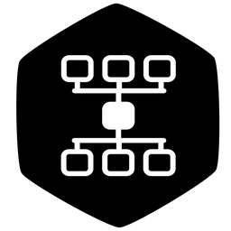
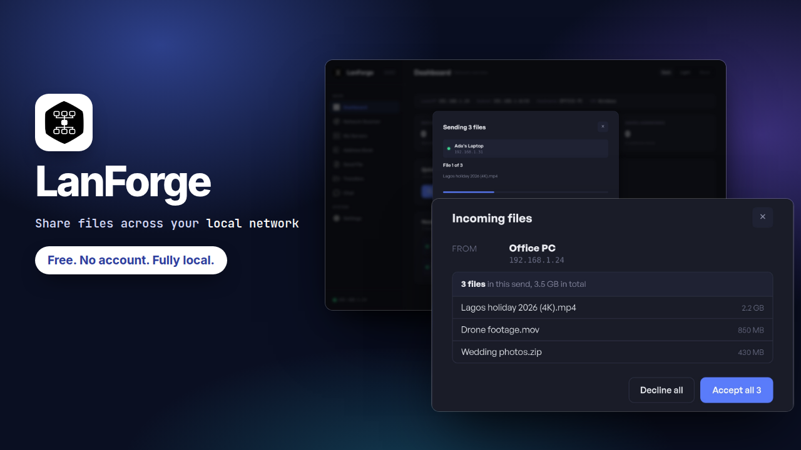
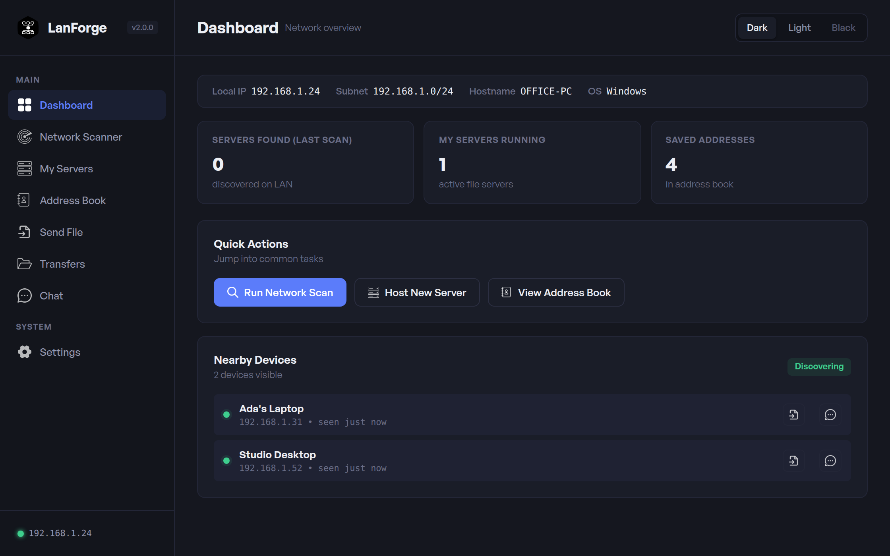
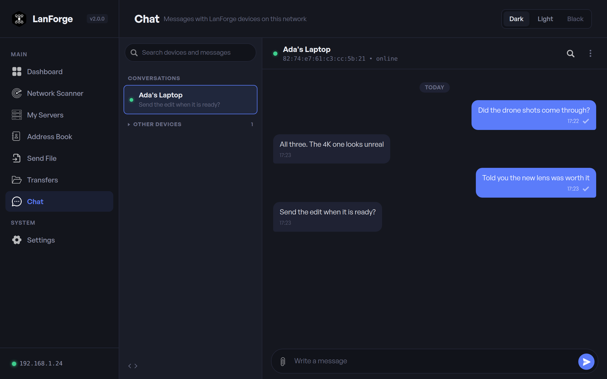
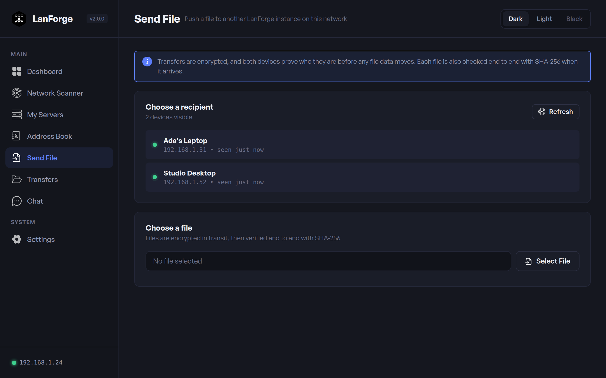
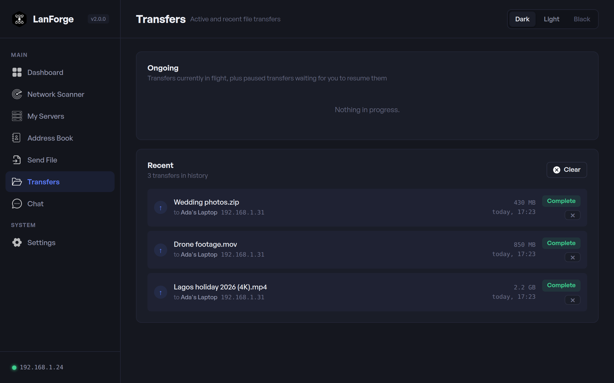
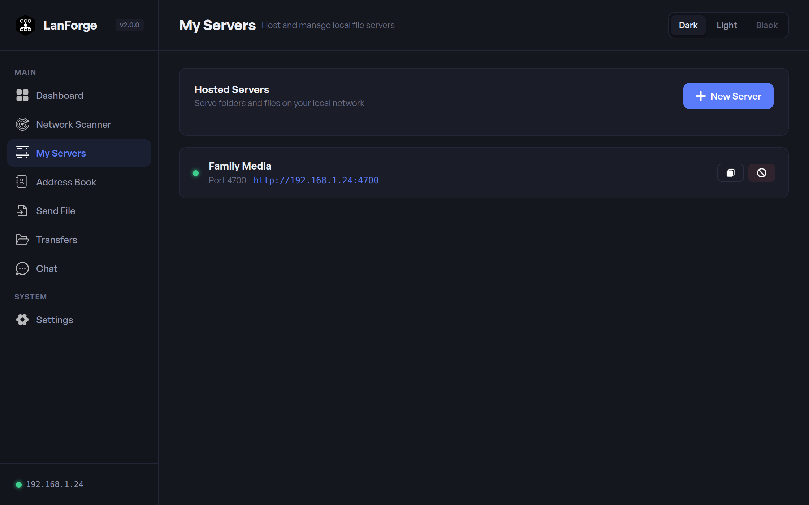

<p align="center">
  
</p>

<h1 align="center">LanForge</h1>

<p align="center">
  A local network toolkit for Windows and Linux.<br>
  Send files and chat between computers, share folders over HTTP, and find web
  servers on your network. No account, no cloud, no internet connection needed.
</p>

<p align="center">
  <a href="https://github.com/tomiwa-adesanya/lanforge/releases/latest"></a>
  
  
</p>

---

## See it in 75 seconds

<p align="center">
  <a href="https://youtu.be/cA528cvTrV4"></a>
</p>

<p align="center"><a href="https://youtu.be/cA528cvTrV4">Watch the LanForge film on YouTube</a></p>

---

## What is LanForge?

LanForge is a desktop app for the network you are already on: your home, office
or classroom Wi-Fi. It does four things.

- **Send** files straight to other computers running LanForge. Pick several at
  once, the other computer answers once, and every file is encrypted on the way
  and checked when it arrives.
- **Chat** with any computer running LanForge on your network, and drop files
  straight into the conversation.
- **Host** any folder as a small web server that other devices can open in a
  browser, with an optional password.
- **Scan** the network for web servers and tell you what each one is.

Everything stays on your local network. LanForge never talks to a server of its
own.


*Dashboard: nearby devices, running servers and saved addresses at a glance*

---

## New in 2.0.0

- **Encrypted transfers.** Every file transfer and chat message between LanForge
  devices is encrypted, and both devices prove who they are before anything is
  sent.
- **Chat.** Message any LanForge device on your network, and send files from
  inside the conversation.
- **Send many files at once.** One approval for the whole set, one progress
  window on both ends, and a queue that survives a crash.

LanForge 2.0.0 cannot send files to, or receive files from, LanForge 1.x. Update
every computer you use it on. A computer still running 1.x shows on the
Dashboard as **Update required** rather than disappearing.

---

## Features

**Send files between computers**

- Nearby computers running LanForge appear on the dashboard automatically.
- Pick a device and one or more files, then send. Files picked together arrive
  as one offer: the other person sees the whole list and answers once with
  **Accept all** or **Decline all**. An offer they ignore expires after 60
  seconds.
- One progress window follows the whole set on both computers, naming the file
  moving now and counting the ones finished.
- Files go one at a time through a queue that is saved as it changes, so a
  crash or a restart picks the rest up again at the next launch.
- Every transfer is encrypted, and both computers check each other's certificate
  before any file data moves. Each computer's fingerprint is shown in
  Settings, so you can compare it with the other person's screen and be certain
  you are sending to the right device.
- Every file is also checked with SHA-256 when it arrives. A file that does not
  match exactly is never saved as complete.
- Pause and resume: an interrupted transfer continues from where it stopped
  instead of starting again.
- Choose where received files go, cap the largest file you will accept (default
  5 GB, up to 50 GB), and choose how long unfinished downloads are kept for
  resuming.
- A Transfers page shows what is in progress, what is paused, and your last 50
  completed, declined or cancelled transfers.
- Receiving is off by default. Turn on Receive Mode in Settings when you want
  this computer to be visible and able to receive.

**Chat**

- Message any computer running LanForge on your network. Messages are encrypted
  in transit and kept only on the two computers.
- No pairing step: a computer you have not talked to before arrives as a message
  request, and accepting the conversation is the permission.
- Send files from inside a conversation, or drag them from your desktop onto it.
  In a conversation you have accepted, files up to a size you choose (100 MB by
  default) arrive without a prompt; larger ones still ask.
- A computer whose conversation you have not accepted cannot send you a file.
- Images and audio open in a built-in viewer. LanForge will not open a program or
  a script for you, whatever its name; it offers Show in folder instead.
- Reply to a message, find in a conversation, read receipts, disappearing
  messages, focus mode and a nickname for each conversation.
- Select several messages to copy, forward or delete them together.
- A message to a computer that is offline waits and goes when it comes back.
  Files need the other computer to be there.

**My Servers**

- Share any folder on your computer as a web server on a port from 4700 to 4750.
- Anyone on the same network opens the link in their browser to browse and
  download files. No app needed on their side.
- Images, video and audio carry Copy URL, Open and Download buttons. Copy URL
  gives the full address, ready to paste into VLC or another player.
- Optional password. Visitors sign in once and stay signed in for 24 hours.
- Videos stream with full seeking, so a browser can jump to any point in a
  large file.
- Run several servers at once, each with its own label.
- The share link updates on its own if your network changes.

**Network Scanner**

- **Quick Scan:** checks every address on your network against 42 common web
  ports.
- **LanForge Scan:** finds folders shared by other LanForge users (ports
  4700-4750). By default it only checks devices that are already visible, which
  is fast. Turn on Aggressive LanForge Scan in Settings to sweep the whole
  network and find devices that are not announcing themselves.
- **Custom Scan:** choose the address range, port range, timeout and number of
  threads.
- Each result shows the address, protocol, status code, page title, hostname
  and the server type it recognises: Apache, Nginx, XAMPP, IIS, LiteSpeed,
  Caddy, Tomcat, Node.js, Python, PHP, Gunicorn, Lighttpd, OpenResty or
  LanForge.
- Filter results by server type.
- Optional auto-rescan every 15 seconds, 30 seconds, 1 minute, 5 minutes or 15
  minutes, after your first manual scan.

**Runs in the background**

- Closing the window hides LanForge to the system tray. Discovery, receiving,
  chat and your shared folders keep running.
- Right-click the tray icon and use **Send file to** to send one or more files
  to a nearby device without opening the window.
- A notification appears when someone sends you a file or a message. Click it to
  bring LanForge back.
- Optional: start LanForge automatically when you log in, straight to the tray.
- Opening LanForge a second time shows the copy that is already running.
- Quit completely with **Exit** in the tray menu.

**Address Book**

- Save the addresses you recognise with a name, and scan results show that name.
- Export your address book to a file for backup, and import it later.

**Appearance**

- Three themes: Dark, Light and Pitch Black.

**Keyboard shortcuts**

| Action                         | Shortcut |
| ------------------------------ | -------- |
| Dashboard                      | Ctrl+1   |
| Network Scanner                | Ctrl+2   |
| My Servers                     | Ctrl+3   |
| Address Book                   | Ctrl+4   |
| Send File                      | Ctrl+5   |
| Transfers                      | Ctrl+6   |
| Settings                       | Ctrl+7 or Ctrl+, |
| Chat                           | Ctrl+8   |
| In and out of full chat mode   | Ctrl+C (when there is nothing selected to copy) |
| Find in a conversation         | Ctrl+F   |
| Close a conversation, or hide to tray | Ctrl+W |
| Close a dialog                 | Escape   |

---

## Screenshots


*Chat: talk to another computer on your network and send it files*


*Send File: pick a nearby device and the files to send*


*Transfers: what is moving now, and everything recently sent and received*


*My Servers: a shared folder with its link for other devices*

---

## System requirements

**Windows**

- Windows 10 or Windows 11, 64-bit (x64)
- Microsoft Edge WebView2 Runtime. It is already included with Windows 11 and
  current Windows 10. If the window does not open, install it from
  [Microsoft](https://developer.microsoft.com/en-us/microsoft-edge/webview2/).

**Linux**

- A 64-bit Debian or Ubuntu based distribution
- GTK 3 and WebKitGTK. The `.deb` package installs these for you.

---

## Download and install

Download the latest version from the
[Releases](https://github.com/tomiwa-adesanya/lanforge/releases/latest) page.

### Windows

| File                                             | What it is                                                                          |
| ------------------------------------------------ | ----------------------------------------------------------------------------------- |
| `lanforge-v<version>-windows-x64-setup.exe`      | Installer (recommended). Adds a Start menu shortcut and, if you choose, a desktop icon. |
| `lanforge-v<version>-windows-x64-standalone.zip` | Portable. Extract anywhere and run `LanForge.exe`.                                  |

LanForge is not code signed yet, so Windows SmartScreen may warn the first time
you run it. Choose **More info**, then **Run anyway**.

Installing 2.0.0 over 1.0.0 upgrades it in place and keeps your settings and
address book.

### Linux

| File                                              | What it is                                                                 |
| ------------------------------------------------- | -------------------------------------------------------------------------- |
| `lanforge_<version>_amd64.deb`                    | Debian and Ubuntu package (recommended). Adds LanForge to your applications menu and installs everything it needs. |
| `lanforge-v<version>-linux-x64-standalone.tar.xz` | Portable. Extract and run the `LanForge` binary.                           |

Install the `.deb` with:

```
sudo apt install ./lanforge_<version>_amd64.deb
```

The portable Linux binary needs these system packages, which the `.deb`
would otherwise install for you:

```
sudo apt install python3-gi python3-gi-cairo gir1.2-gtk-3.0 gir1.2-webkit2-4.1 gir1.2-ayatanaappindicator3-0.1 zenity
```

On older distributions, use `gir1.2-webkit2-4.0` in place of `gir1.2-webkit2-4.1`.

### Verify your download

Every release includes a `SHA256SUMS.txt` file. To check a download on Windows:

```
Get-FileHash .\lanforge-v<version>-windows-x64-setup.exe -Algorithm SHA256
```

On Linux:

```
sha256sum -c SHA256SUMS.txt --ignore-missing
```

The hash must match the line for that file in `SHA256SUMS.txt`. Windows shows
it in capital letters; that is the same hash.

---

## Getting started

**Send files**

1. On both computers, open **Settings** and turn on **Receive Mode**. Set a
   device name under **Alias** so the other person recognises you.
2. On the sending computer, find the other computer under **Nearby Devices** on
   the Dashboard (or open **Send File**), choose it, and pick one or more files.
3. The receiving computer shows the offer with every file in it. Accept it
   within 60 seconds.

Received files go to `Downloads/LanForge` in your home folder unless you choose
another folder in Settings. Files received in chat go to a `Chat` folder inside
it, one folder per sender.

**Chat**

1. With Receive Mode on, use the chat button next to a computer under **Nearby
   Devices**, or open **Chat** (Ctrl+8).
2. Your first message arrives on the other computer as a request. Once they
   accept, you can send messages and files freely.

**Share a folder**

1. Open **My Servers** and choose **New Server**.
2. Pick a folder, a port between 4700 and 4750, and optionally a password.
3. Give the link shown to anyone on the same network. They open it in a browser.

**Start hidden at login**

Turn on **Start at login (background)** in Settings. You can also start
LanForge hidden in the tray yourself by launching it with `--background`.

---

## Network and firewall

LanForge only uses your local network. It listens on:

| Port          | Protocol | Used for                                         |
| ------------- | -------- | ------------------------------------------------ |
| 4751          | UDP      | Finding nearby LanForge devices                  |
| 4752          | TCP      | Receiving files and chat messages (encrypted)    |
| 4700 to 4750  | TCP      | Folders you share in My Servers                  |

If your firewall asks, allow LanForge on **private** networks. If you block it,
scanning still works, but other devices cannot see you, send you files, chat
with you or open your shared folders.

All devices must be on the same network. Many public and guest Wi-Fi networks
block devices from reaching each other, and LanForge cannot work across that.

---

## Your data

LanForge stores nothing online. Your settings, address book, device name, chat
history and this computer's certificate are kept in a single folder on your
computer:

| OS      | Location                  |
| ------- | ------------------------- |
| Windows | `%APPDATA%\LanForge`      |
| Linux   | `~/.config/LanForge`      |

To back up, copy that folder. To reset LanForge, delete it. The certificate in
that folder is this computer's identity on the network: after a reset, other
computers see it as a new device.

---

## Changelog

### v2.0.0 (2026-10-20): Encrypted transfers, chat and multi-file sending

Every transfer and chat message is encrypted, with both devices verified by
certificate. New: chat between computers, with files sent from inside a
conversation. Send many files at once with one approval and one progress
window. Copy URL, Open and Download buttons in shared folders. Cannot exchange
files with LanForge 1.x. Full notes on the
[release page](https://github.com/tomiwa-adesanya/lanforge/releases/tag/v2.0.0).

### v1.0.0 (2026-09-22): Initial public release

First public release of LanForge: network scanner, folder sharing, file transfer
between computers, system tray and background mode.

---

## Uninstalling

**Windows (installer):** Settings > Apps, or Control Panel > Programs. If you
turned on Start at login, turn it off in LanForge first. Your data folder is not
removed; delete it yourself for a clean removal.

**Windows (portable):** turn off Start at login in LanForge if you used it, then
delete the extracted folder.

**Linux (.deb):**

```
sudo apt remove lanforge
```

**Linux (portable):** turn off Start at login in LanForge if you used it, then
delete the extracted files.

---

## Known limitations

- **Shared folders are not encrypted.** Folders in My Servers use plain HTTP so
  any browser on the network can open them without a certificate warning. A
  password on a shared folder keeps casual visitors out; it does not protect
  against someone watching the network. Transfers and chat between LanForge
  computers are encrypted.
- **Chat is not a secure messenger.** Messages are encrypted on the network, but
  the chat history on each computer is stored unencrypted, and device names
  are visible on the network. Use your operating system's disk encryption to
  protect a computer someone else could access.
- **2.0.0 and 1.x cannot exchange files.** Update every computer.
- The scanner covers the network your computer is on (the last number of the
  address, 1 to 254). It does not scan other subnets.
- Shared folders are read-only. Visitors can browse, download and stream, but
  cannot upload.
- Files in a multi-file send go one at a time, not in parallel.
- On Linux, the tray icon needs a desktop with tray support. Ubuntu has it by
  default. On desktops without it, closing the window quits LanForge instead of
  hiding it.
- Transfer speed is limited by your network. Wi-Fi is usually much slower than
  a wired connection.

---

## Support

Found a bug or have an idea? Open an issue on the
[Issues](https://github.com/tomiwa-adesanya/lanforge/issues) page. For bugs,
include your LanForge version (shown in the sidebar and in Settings > About) and
your operating system.

---

## License

LanForge is proprietary software. All rights reserved. See [LICENSE](LICENSE)
for details.
